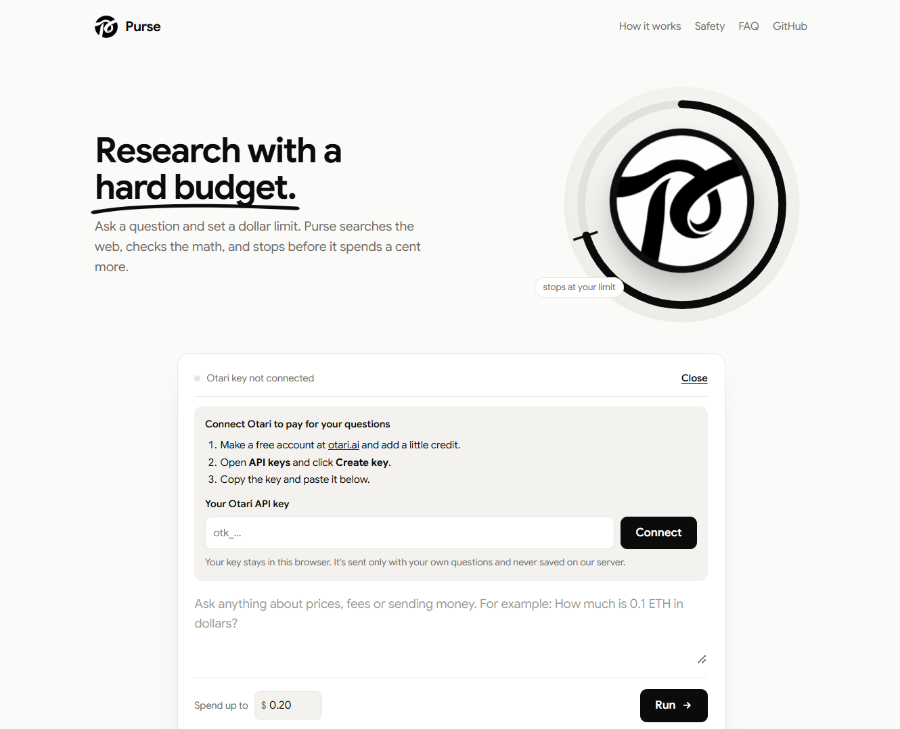
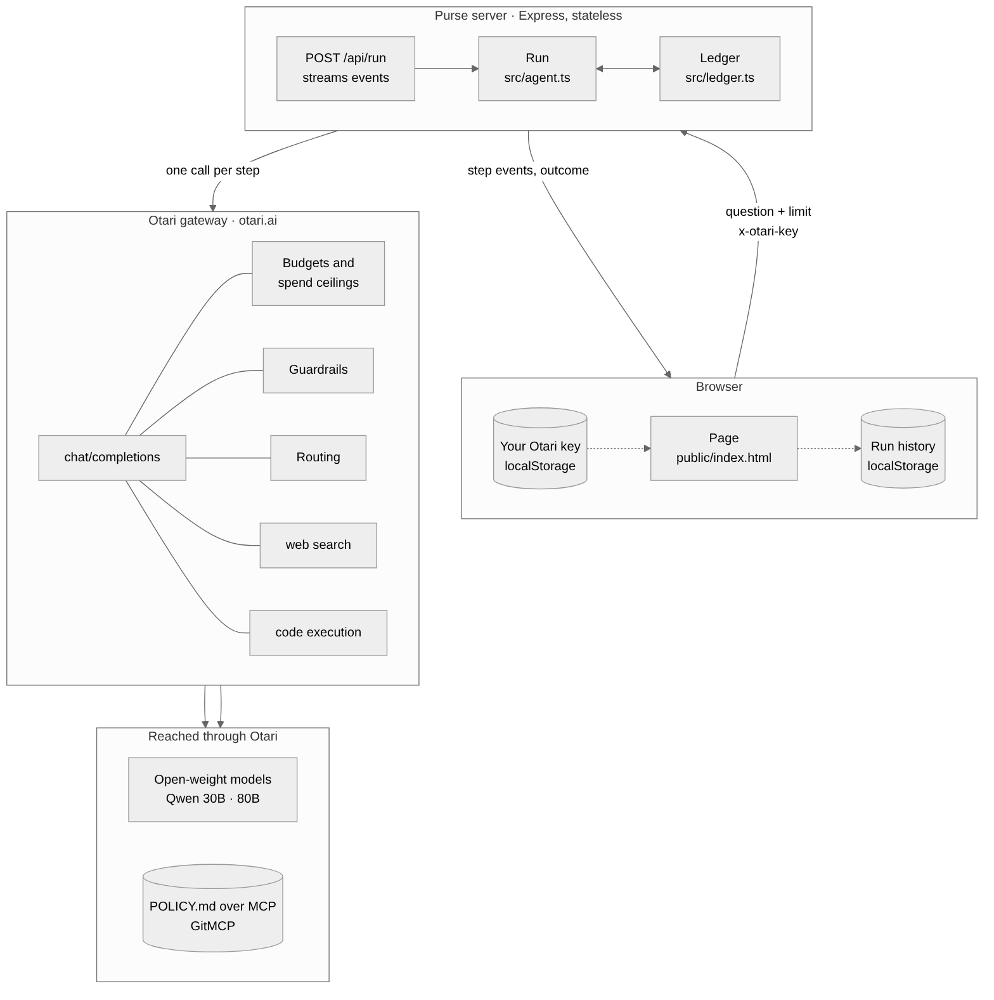
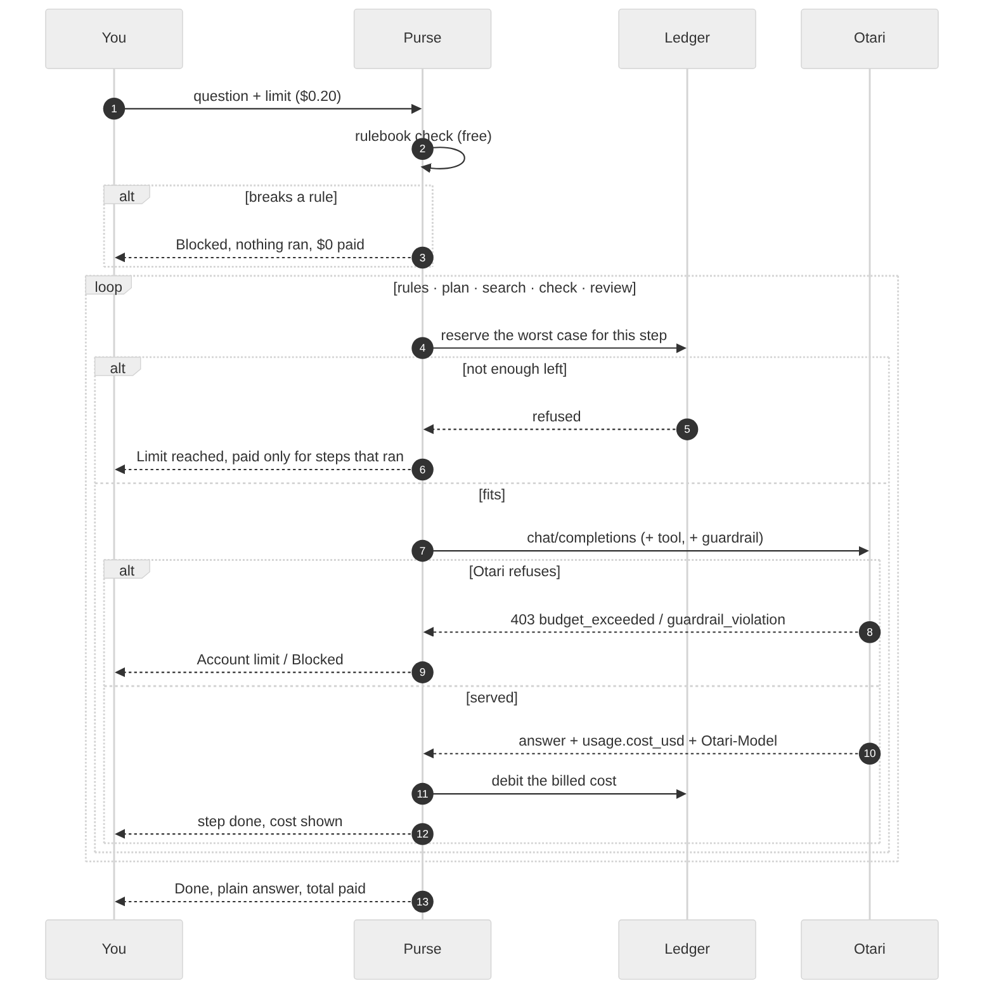
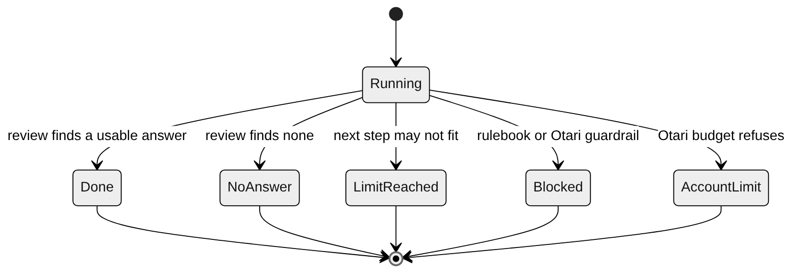

<p align="center"></p>

<h1 align="center">Purse</h1>

<p align="center"><b>Research with a hard budget.</b><br />
Ask a question, set a dollar limit. Purse searches the web, checks the math in code,<br />
and stops before it spends a cent past your limit.</p>

<p align="center">
  <a href="https://usepurse.vercel.app"><b>usepurse.vercel.app</b></a> ·
  <a href="#run-it-yourself">Run it yourself</a> ·
  <a href="#how-it-works">How it works</a> ·
  <a href="SECURITY.md">Security</a>
</p>

<p align="center">
  <a href="https://usepurse.vercel.app"></a>
  <a href="https://github.com/thesithunyein/purse/actions/workflows/ci.yml"></a>
  <a href="LICENSE"></a>
  
  
  <a href="https://otari.ai"></a>
  
</p>

<p align="center"></p>

---

## Why

AI agents spend money one call at a time, and you see the total afterwards on an
invoice. A spend limit in a config file only fails a request once the money is
already gone.

Purse gives every question a budget **before** it starts. Each step must fit in
what's left, or it doesn't run. You see what every step cost, and what Otari
actually billed.

## Use it

1. Open **[usepurse.vercel.app](https://usepurse.vercel.app)**.
2. Connect your own [Otari](https://otari.ai) API key. Purse checks it for free, and
   it stays in your browser.
3. Ask a question and set a limit. Most questions cost about **2¢**.

No wallet, no sign-up with us, no crypto needed. Purse only reads public prices
and fees. It can't move money.

## How it works

### Architecture

<p align="center"></p>

<sub>Source: [docs/diagrams/architecture.mmd](docs/diagrams/architecture.mmd)</sub>

The server keeps nothing between requests. One request runs one question and
streams it back, so it runs the same on one machine or on serverless hosts.

### One question, step by step

<p align="center"></p>

<sub>Source: [docs/diagrams/request.mmd](docs/diagrams/request.mmd)</sub>

### How a run ends

<p align="center"></p>

<sub>Source: [docs/diagrams/endings.mmd](docs/diagrams/endings.mmd)</sub>

Every ending reports what Otari actually billed (`billedUsd`). A blocked request
before any model call costs nothing.

### The steps

| Step | Model | Otari feature | What it does |
|---|---|---|---|
| Check the request | none | — | Refuses moving all funds, seed phrases, or override attempts, before any spend |
| Read the rules | Qwen 30B | **MCP** | Reads [`POLICY.md`](POLICY.md) from this repo, so rules live outside the prompt |
| Plan | Qwen 30B | open-weight model | At most three steps |
| Search the web | Qwen 30B | **`otari_web_search`** | Finds the facts and their sources |
| Check the numbers | Qwen 30B | **`otari_code_execution`** | Runs the arithmetic instead of guessing |
| Review the answer | Qwen 80B | second open-weight model | Says if the answer holds up, writes it in plain words |

The small model does the many cheap steps. The larger one makes the single
decision that matters. All dollar amounts are computed in code, never by a model.

### What a question costs

Measured on the live site:

| Step | Cost |
|---|---|
| Read the rules (MCP) | $0.0034 |
| Plan | $0.00003 |
| Search the web | $0.0104 |
| Check the numbers | $0.0101 |
| Review the answer | $0.0001 |
| **Total** | **about $0.024** |

Almost all of it is the two tool calls. That's why each step reserves its own
worst case: a budget that covers twenty chat calls may not cover one search.

## Built on Otari

| Otari feature | Status | Where |
|---|---|---|
| Open-weight models (two) | Live | `PURSE_LOOP_MODEL`, `PURSE_SETTLE_MODEL` |
| Web search, code execution | Live | research and verify steps |
| MCP, inline `mcp_servers` | Live | rules step, `PURSE_MCP_URL` |
| Per-key budgets, `budget_exceeded` refusals | Live | ends as **Account limit**, scope shown |
| Cost per call (`usage.cost_usd`) | Live | every step's cost |
| Guardrails (`guardrails` field, `Otari-Guardrails`) | Supported | set `PURSE_GUARDRAIL_PROFILE` after adding one in Otari |
| Routing fallbacks (`Otari-Model`, `Otari-Fallback`) | Supported | see [routing/README.md](routing/README.md) |
| End-user budgets (service keys) | Supported | `PURSE_SERVICE_KEY` |

## Run it yourself

Needs Node.js 20 or newer.

```bash
git clone -b otari https://github.com/thesithunyein/purse
cd purse
npm install
cp .env.example .env
npm run dev
```

Open http://localhost:3000 and connect your key, or put shared keys in `.env`.
Set `PURSE_MOCK=1` to try the whole flow without spending anything.

```bash
npm test          # ledger, gateway client and every ending, network stubbed
npm run typecheck
```

### Deploy

**Vercel:** import the repo and add the variables from `.env.example`. Vercel
finds `src/server.ts` and serves `public/`. No `vercel.json` needed.
**Docker or Render:** `Dockerfile` and `render.yaml` are included.

On a public deploy with shared keys, set `PURSE_ACCESS_CODE`, and keep
`PURSE_MAX_BUDGET_USD` low. Visitors who bring their own key need neither.

### Configuration

| Variable | Default | Purpose |
|---|---|---|
| `PURSE_LOOP_MODEL` | `alibaba/qwen3-30b-a3b-instruct-2507` | Model for rules, plan, search, check |
| `PURSE_SETTLE_MODEL` | `alibaba/qwen3-next-80b-a3b-instruct` | Model for the review |
| `PURSE_MCP_URL` | empty | MCP server for the rules step, e.g. `https://gitmcp.io/thesithunyein/purse` |
| `PURSE_MAX_BUDGET_USD` | `1.00` | Most a single question may spend |
| `PURSE_RESERVE_PLAIN_USD` / `_TOOL_USD` | `0.001` / `0.03` | Worst case reserved before each step |
| `PURSE_GUARDRAIL_PROFILE` | empty | Otari guardrail run on every step in block mode |
| `PURSE_KEY_ALICE` / `_BOB` | empty | Optional shared accounts |
| `PURSE_ACCESS_CODE` | empty | Required for shared accounts when set |
| `PURSE_MOCK` | `0` | `1` simulates every call |

## Project layout

```
public/            the page, logo and icons (served as static files)
src/server.ts      Express app: /api/state, /api/key, /api/run (streamed)
src/agent.ts       a run: steps, reserves, endings
src/ledger.ts      budget, reserve, debit
src/otari.ts       Otari client: tools, MCP, guardrails, headers, errors
src/config.ts      settings from the environment
test/              node:test suites, no network
POLICY.md          the rules read over MCP
routing/           how to set up a routing fallback
```

## Limits

- Answers come from the web at that moment. Prices change by the minute. It is not
  financial advice.
- An edge timeout (HTML 502/504) arrives with no cost, so Purse books that step's
  reserve as an estimate and marks it.
- Guardrails and routing need setup in your Otari organization first.

## Contributing

Issues and pull requests are welcome. Read [CONTRIBUTING.md](CONTRIBUTING.md) and
the [Code of Conduct](CODE_OF_CONDUCT.md). Report security issues privately, as
described in [SECURITY.md](SECURITY.md).

## License

[MIT](LICENSE) © Sithu Nyein
